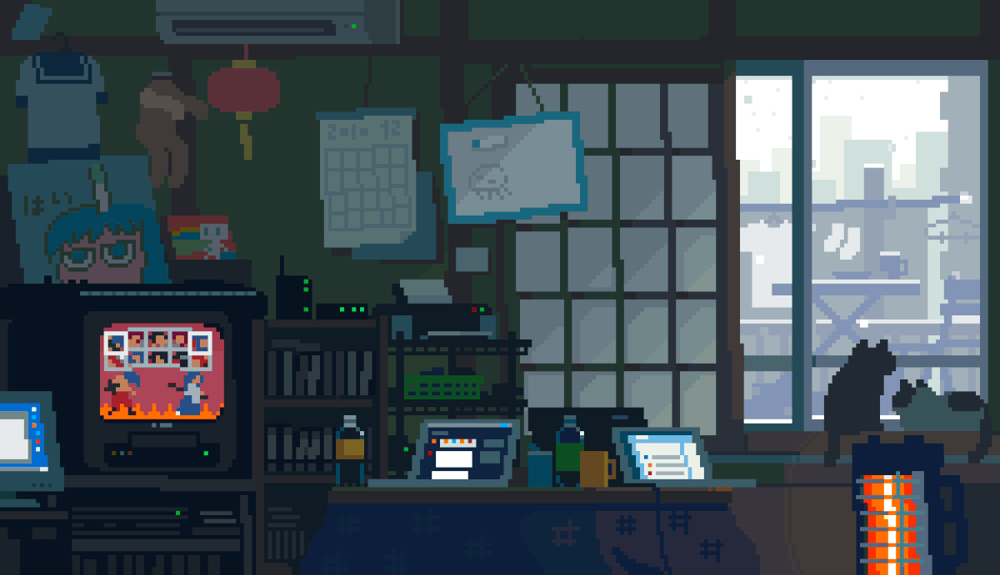

<!-- HERO -->

<!-- INTRO -->
<table width="100%">
<tr>
<td width="65%" valign="top"><h2>👋 Hey, I'm Edgar</h2>
I'm a <strong>Backend Developer</strong> focused on building applications with the Java ecosystem.

I enjoy working on the parts users don't always see:

<strong>APIs · business logic · databases · authentication · integrations · architecture</strong>

My main stack revolves around:
<blockquote>☕ <strong>Java</strong> + 🌱 <strong>Spring Boot</strong> + 🐘 <strong>PostgreSQL</strong> + 🐳 <strong>Docker</strong></blockquote>
I'm continuously learning how to design cleaner, more maintainable and reliable backend systems.
</td>
<td width="35%" valign="top"><pre>╭─────────────────────────╮
│       SYSTEM.INFO       │
├─────────────────────────┤
│                         │
│  👨‍💻  ROLE               │
│      Backend Developer  │
│                         │
│  ☕  JVM                 │
│      Java 21            │
│                         │
│  🐧  OS                 │
│      Linux              │
│                         │
│  📦  CONTAINERS         │
│      Docker             │
│                         │
│  🟢  STATUS             │
│      Building...        │
│                         │
╰─────────────────────────╯</pre></td>
</tr>
</table>
<!-- STACK -->

<h2 align="center">🧰 Technologies I Use</h2>

Backend • Databases • Infrastructure • Development Tools

<!-- WHAT I BUILD -->

<h2 align="center">🧩 What I Build</h2>

<table>
<tr>
<td align="center" width="25%" valign="top">
<h3>🔌</h3>
<strong>APIs</strong>
  
RESTful services 
JSON 
HTTP 
Integrations
</td>
<td align="center" width="25%" valign="top">
<h3>🔐</h3>
<strong>Security</strong>
  
Spring Security 
JWT 
Authentication 
Authorization
</td>
<td align="center" width="25%" valign="top">
<h3>🗄️</h3>
<strong>Data</strong>
  
PostgreSQL 
Oracle 
MySQL 
JPA / Hibernate
</td>
<td align="center" width="25%" valign="top">
<h3>🐳</h3>
<strong>Infrastructure</strong>
  
Docker 
Linux 
Git 
Environment setup
</td>
</tr>
</table>

<!-- PROJECTS -->

<h2 align="center">🚀 Things I'm Building</h2>

<table>
<tr>
<td width="50%" align="center" valign="top">
<h2>🦷 Consultorio</h2>
<h3><code>Dental SaaS</code></h3>
 

  

A reusable backend platform for dental clinics.

<strong>Focus</strong>

<code>Multi-tenant</code> · <code>Security</code> 
<code>Users</code> · <code>Schedules</code> · <code>Appointments</code>

<strong>Stack</strong>

<code>Java 21</code> · <code>Spring Boot</code> 
<code>PostgreSQL</code> · <code>Docker</code>

🟣 <strong>ACTIVE DEVELOPMENT</strong>

</td>
<td width="50%" align="center" valign="top">
<h2>🛍️ Belomora</h2>
<h3><code>E-Commerce</code></h3>
 

  

A custom fashion e-commerce platform.

<strong>Focus</strong>

<code>Products</code> · <code>Cart</code> · <code>Orders</code> 
<code>Payments</code> · <code>Webhooks</code> · <code>JWT</code>

<strong>Stack</strong>

<code>Java</code> · <code>Spring Boot</code> 
<code>React</code> · <code>PostgreSQL</code>

💗 <strong>ACTIVE DEVELOPMENT</strong>

</td>
</tr>
</table>

<!-- LEARNING -->

<h2 align="center">🌱 Currently Learning</h2>

Always learning. Always building. Always breaking something first.

<!-- DEVELOPMENT LOOP -->

<h2 align="center">🔄 The Development Loop</h2>
💡 Idea → 🏗️ Design → ☕ Code → 🧪 Test → 🐳 Containerize → 🚀 Ship

<!-- GITHUB STATS -->

<h2 align="center">📊 GitHub Activity</h2><!-- Las dos tarjetas de github-readme-stats se omiten porque actualmente no cargan en GitHub. -->

<!-- CONTRIBUTIONS -->

<picture>
<source media="(prefers-color-scheme: dark)" srcset="https://raw.githubusercontent.com/edgarsanchez01/edgarsanchez01/output/github-contribution-grid-snake-dark.svg" />
<source media="(prefers-color-scheme: light)" srcset="https://raw.githubusercontent.com/edgarsanchez01/edgarsanchez01/output/github-contribution-grid-snake.svg" />

</picture>

<!-- FUN -->

<h2 align="center">🐧 Outside the Code</h2>
☕ Coffee &nbsp;•&nbsp; 🐧 Linux &nbsp;•&nbsp; 🎧 Music &nbsp;•&nbsp; 🕹️ Pixel Art &nbsp;•&nbsp; 🚀 Building Projects

<em>Build it. Break it. Understand it. Build it better.</em>

Thanks for stopping by 👾

<!-- CONNECT -->

<h2 align="center">🌐 Find Me</h2>
  

☕ Built with Java · 🌱 Spring · 🐧 Linux · 🤓 curiosity

